# HotelPro — نظام إدارة الفنادق المتكامل (Enterprise Hotel Management System)

[](https://dotnet.microsoft.com/)
[](https://angular.dev/)
[](https://learn.microsoft.com/ef/core/)
[](https://www.typescriptlang.org/)
[](#البنية-المعمارية-architecture)

**HotelPro** هو نظام مؤسسي متكامل لإدارة الفنادق والمنشآت السياحية (**HMS**)، تم بناؤه باستخدام **ASP.NET Core 10 Web API** وفق معمارية **Clean Architecture** مع **Entity Framework Core + SQL Server** في الواجهة الخلفية، و**Angular 21** (Standalone Components + Angular Material + Signals) في الواجهة الأمامية، مع دعم كامل للغتين **العربية والإنجليزية (AR/EN)** والتحويل التلقائي لاتجاه التصميم (**RTL / LTR**).

صُمم النظام ليغطي دورة العمل الفندقية بالكامل من الحجوزات والتسعير الديناميكي إلى الاستقبال، التدبير المنزلي، الصيانة، الفوترة والمدفوعات، الموارد البشرية، المخزون، ولوحة المؤشرات والتقارير التنفيذية.

---

## أبرز المميزات الهندسية (Engineering Highlights)

- **معمارية نظيفة وفصل المسؤوليات (Clean Architecture)**:
  تقسيم واضح بين الطبقات (`Domain`, `Application`, `Infrastructure`, `API`, `Tests`) دون أي تبعيات دائرية.
- **أمان متقدم وصلاحيات دقيقة (RBAC & JWT Security)**:
  - **9 أدوار تشغيلية** وأكثر من **50 صلاحية دقيقة** (`PermissionsCatalog`) تُطبق عبر `PermissionAuthorizationHandler` و`PermissionPolicyProvider` في الخادم، وعبر Route Guards وDirective `*hasPermission` في الواجهة الأمامية.
  - مصادقة **JWT Bearer** مع تدوير رمز التحديث (**Refresh Token Rotation**)، واكتشاف إعادة استخدام الرموز وإلغائها، وتسجيل العمليات الحساسة في `AuditLog`.
  - معالج استثناءات مركزي (`GlobalExceptionHandlerMiddleware`) لإرجاع أخطاء موحدة وآمنة دون تسريب تفاصيل الخادم.
- **تكامل المعاملات ومنع التضارب (Transactional Integrity & Concurrency)**:
  - **منع الحجز المزدوج (Double-Booking Prevention)**: إنشاء وتعديل الحجوزات يتم داخل معاملات قاعدة بيانات بمستوى عزل `IsolationLevel.Serializable` مع فحص التداخل وتثبيت الأسعار الليلية.
  - **معاملات مالية آمنة (Idempotent Billing)**: دعم مفتاح منع التكرار (`IdempotencyKey`) في المدفوعات وسجلات عكس الدفع غير القابلة للتعديل داخل معاملات `Serializable`.
  - **إدارة مخزون مضبوطة بالسجلات**: تعديل الكميات يتم حصراً عبر حركات المخزون (`StockTransaction`) واستلام أوامر الشراء مع منع السحب عند عدم توفر الرصيد.
- **ترحيلات قاعدة بيانات معيارية (Modular EF Core Migrations)**:
  تقسيم تغييرات قاعدة البيانات إلى **7 ملفات Migration مستقلة** حسب الوحدات (الهوية، الفندق والغرف، الأسعار والحجوزات، العمليات، الفوترة والمالية، الموارد البشرية والمخزون، الإشعارات) لسهولة الصيانة والتطوير والتراجع عند الحاجة.
- **واجهة أمامية حديثة بـ Angular 21**:
  - استخدام **Standalone Components** مع التحميل الكسول للمسارات (Lazy Loading) وإدارة الحالة التفاعلية عبر **Angular Signals**.
  - هوية بصرية احترافية مخصصة للضيافة (**كحلي `#0F2540` / ذهبي `#C9A227` / أبيض**) مبنية على **Angular Material**.
  - دعم ثنائي اللغة (**عربي / إنجليزي**) عبر `TranslationService` مع تبديل فوري للاتجاه (**RTL / LTR**).
  - طرق عرض متعددة للغرف والحجوزات: الجداول، البطاقات، **خريطة الطوابق (Floor Map)**، و**تقويم الحجوزات التفاعلي (Booking Calendar)**.
- **اختبارات تكامل مؤتمتة (Integration Tests)**:
  مجموعة اختبارات شاملة (`HotelPro.Tests`) باستخدام `WebApplicationFactory<Program>` تغطي الأمان، الصلاحيات، الحجوزات، العمليات، الفوترة، الموارد البشرية، المخزون، والتقارير.

---

## البنية المعمارية (Architecture)

```text
HotelPro
├── backend/
│   ├── HotelPro.Domain/           # الكيانات (Entities)، التعدادات (Enums)، الثوابت (PermissionsCatalog, RoleNames)
│   ├── HotelPro.Application/      # واجهات الخدمات، كائنات نقل البيانات (DTOs)، عقود الأعمال
│   ├── HotelPro.Infrastructure/   # DbContext، ملفات Migrations، الهوية وJWT، تنفيذ الخدمات، DbInitializer
│   ├── HotelPro.API/              # وحدات التحكم (Controllers)، سياسات الصلاحيات، Middleware، Swagger
│   └── HotelPro.Tests/            # اختبارات التكامل (WebApplicationFactory<Program>)
├── frontend/
│   └── hotelpro-angular/          # تطبيق Angular 21 (Standalone Components, Signals, Material, AR/EN i18n)
├── docs/                          # وثائق التحليل والتصميم المعماري
└── README.md
```

---

## التقنيات المستخدمة (Tech Stack)

| الطبقة | التقنيات والأدوات |
|---|---|
| **الواجهة الخلفية (Backend)** | ASP.NET Core 10 Web API, C#, Clean Architecture, Swashbuckle (Swagger/OpenAPI) |
| **قاعدة البيانات والـ ORM** | Entity Framework Core 10, SQL Server (`LocalDB` / SQL Server), Code-First Modular Migrations |
| **الأمان والصلاحيات** | ASP.NET Core Identity, JWT Bearer, Refresh Token Rotation, Policy-Based RBAC |
| **الواجهة الأمامية (Frontend)** | Angular 21, TypeScript, Angular Material 21, Angular Signals, RxJS, HttpClient Interceptors |
| **اللغة وتجربة المستخدم** | نظام ترجمة AR/EN مخصص، تبديل ديناميكي RTL/LTR، قائمة جانبية متجاوبة وجرس إشعارات |
| **الاختبارات (Testing)** | xUnit, `Microsoft.AspNetCore.Mvc.Testing` (`WebApplicationFactory`), EF Core InMemory |

---

## وحدات ومميزات النظام

1. **الهوية والصلاحيات والتدقيق (Identity, RBAC & Audit)**:
   - إدارة المستخدمين، 9 أدوار (`SuperAdmin`, `HotelManager`, `Receptionist`, `Accountant`, `HousekeepingSupervisor`, `HousekeepingStaff`, `MaintenanceManager`, `MaintenanceTechnician`, `ServiceStaff`)، أكثر من 50 صلاحية، وسجل تدقيق للعمليات.
2. **إعدادات الفندق والغرف والنزلاء**:
   - بيانات الفندق وإعدادات الضرائب والعملة، أنواع الغرف، المرافق، إدارة الغرف (جدول / بطاقات / خريطة الطوابق)، وملفات النزلاء والوثائق.
3. **التسعير الديناميكي والحجوزات والتقويم**:
   - خطط أسعار موسمية، مضاعفات عطلة نهاية الأسبوع، خصومات الإقامة الطويلة، حاسبة تسعير فورية، حجوزات متعددة الغرف محمية من التداخل، سجل تغييرات الحالة، وتقويم حجوزات تفاعلي.
4. **العمليات الفندقية (Operations)**:
   - **الاستقبال (Front Desk)**: تسجيل الدخول (Check-In) والمغادرة (Check-Out) مع مزامنة حالة الغرف.
   - **خدمات النزلاء (Guest Services)**: كتالوج الخدمات وطلبات النزلاء.
   - **التدبير المنزلي (Housekeeping)**: إسناد مهام تنظيف الغرف ومتابعة حالتها.
   - **الصيانة (Maintenance)**: بلاغات الأعطال، تعيين الفنيين، وإدارة حالة `OutOfService`.
5. **الفواتير والمدفوعات والمالية (Billing & Finance)**:
   - إصدار الفواتير وبنودها، تحصيل المدفوعات وعكسها بشكل آمن ومقاوم للتكرار، تصنيفات المصروفات، المصروفات التشغيلية، وسجلات الإيرادات.
6. **الموارد البشرية والمخزون (HR & Inventory)**:
   - **الموارد البشرية**: الأقسام، سجل الموظفين، الحضور والانصراف، وطلبات الإجازات واعتمادها.
   - **المخزون والمشتريات**: التصنيفات، الأصناف، الموردون، أوامر الشراء، استلام الشحنات، وسجل حركات المخزون.
7. **لوحة المؤشرات والتقارير والإشعارات**:
   - مؤشرات أداء حية (نسبة الإشغال مع استبعاد غرف الصيانة `OutOfService`، الإيرادات، الحجوزات النشطة)، رسوم بيانية، تقارير الإشغال والحجوزات والمالية مع **تصدير CSV بترميز UTF-8**، وجرس إشعارات في الشريط العلوي مع عداد غير المقروء.

> للاطلاع على البنية الكاملة لقاعدة البيانات (48 جدولاً وعلاقاتها)، راجع: [مخطط قاعدة البيانات الكامل (ERD)](docs/02-database-erd.md)

---

## لقطات من النظام (System Screenshots)

| تسجيل الدخول (Login) | لوحة المؤشرات (Dashboard) |
|---|---|
| 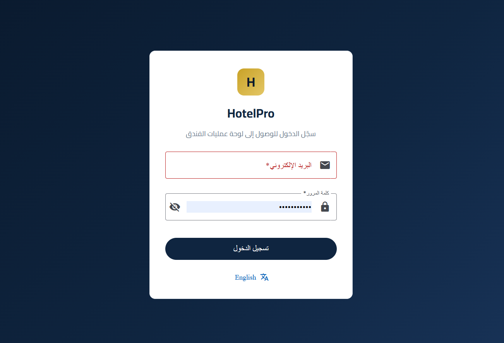 | 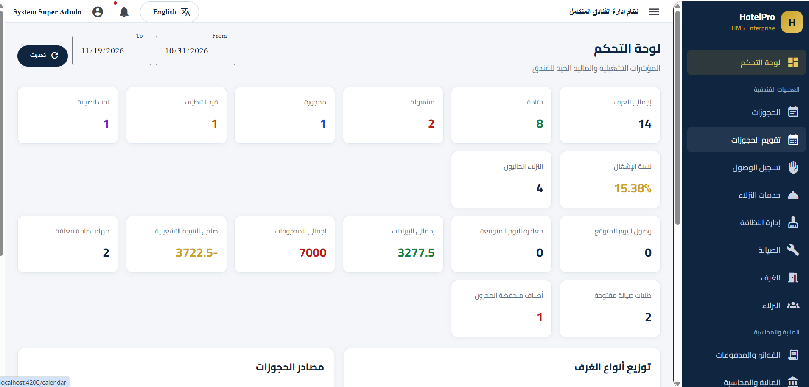 |

| إدارة الحجوزات (Reservations) | الاستقبال: الدخول والمغادرة (Check-In / Check-Out) |
|---|---|
| 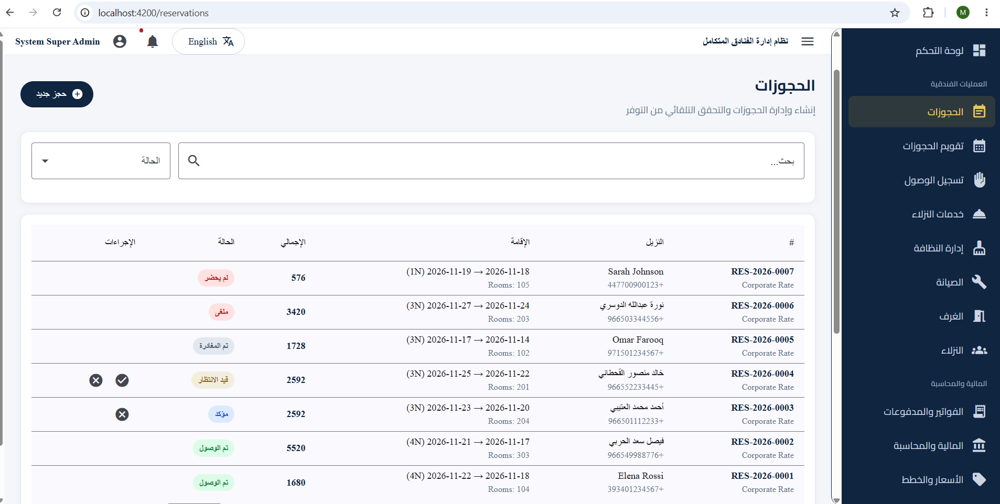 | 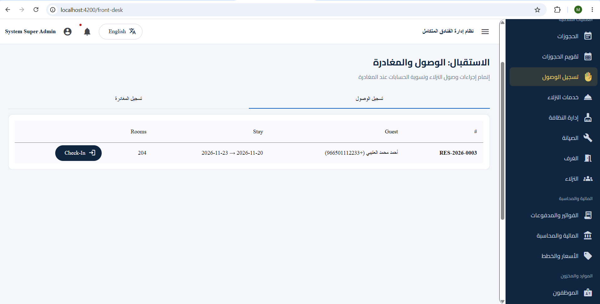 |

| إدارة الغرف وخريطة الطوابق (Rooms Management) | إدارة النزلاء (Guests) |
|---|---|
| 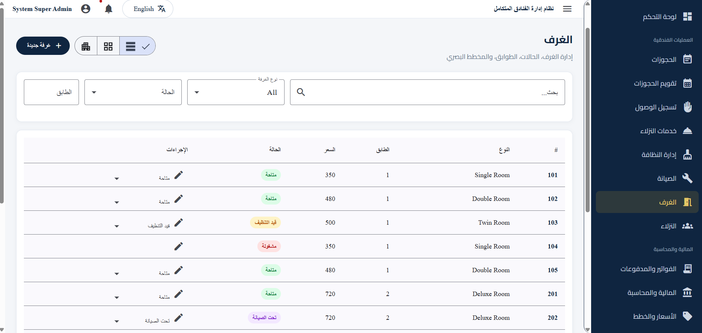 | 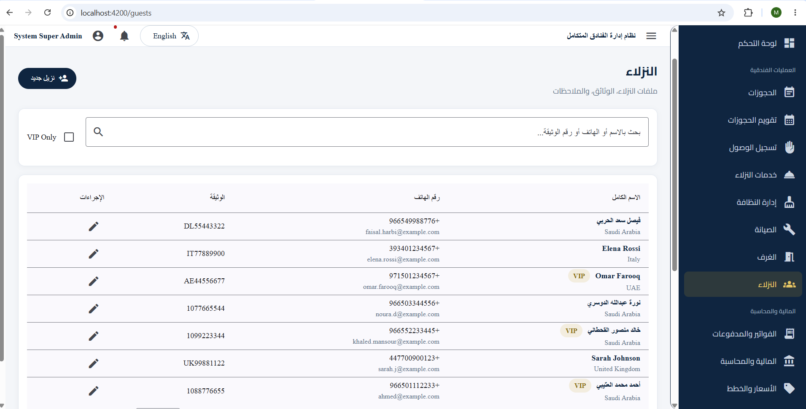 |

| التدبير المنزلي (Housekeeping) | الصيانة (Maintenance) |
|---|---|
| 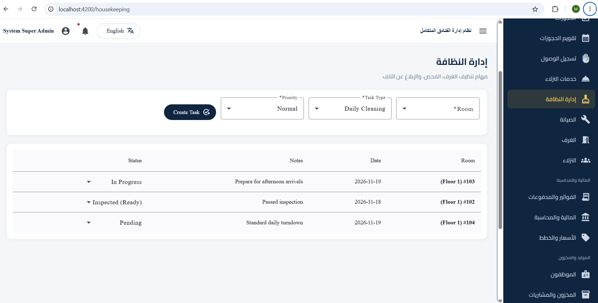 | 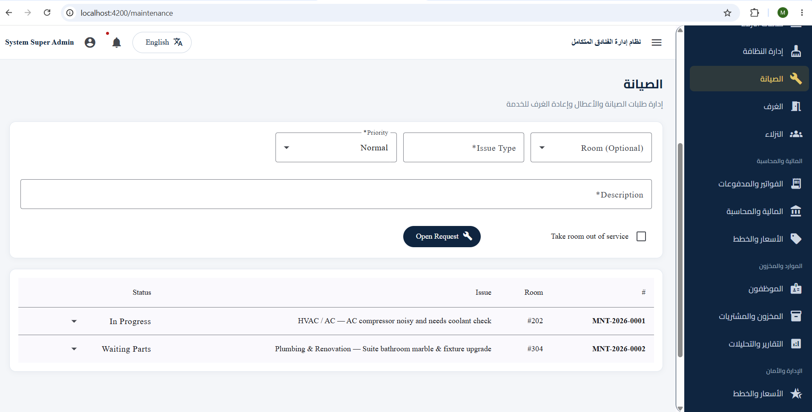 |

| الفواتير والمدفوعات (Billing & Payments) | التقارير والتحليلات (Reports & Analytics) |
|---|---|
| 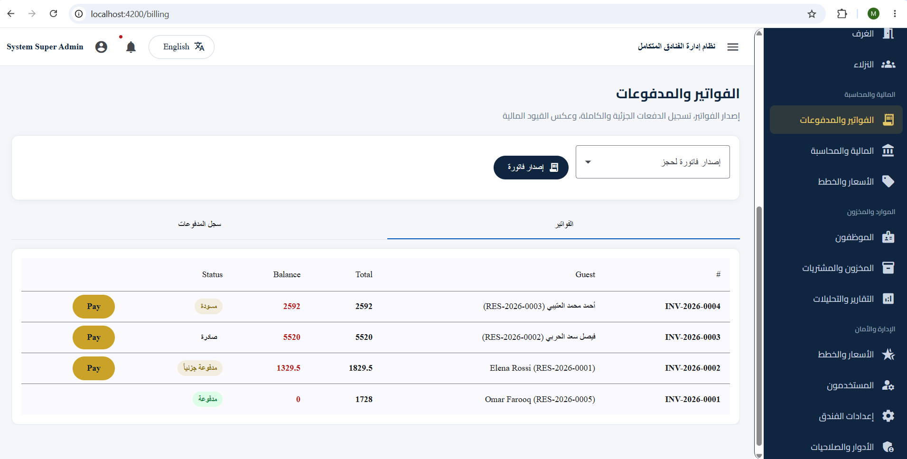 | 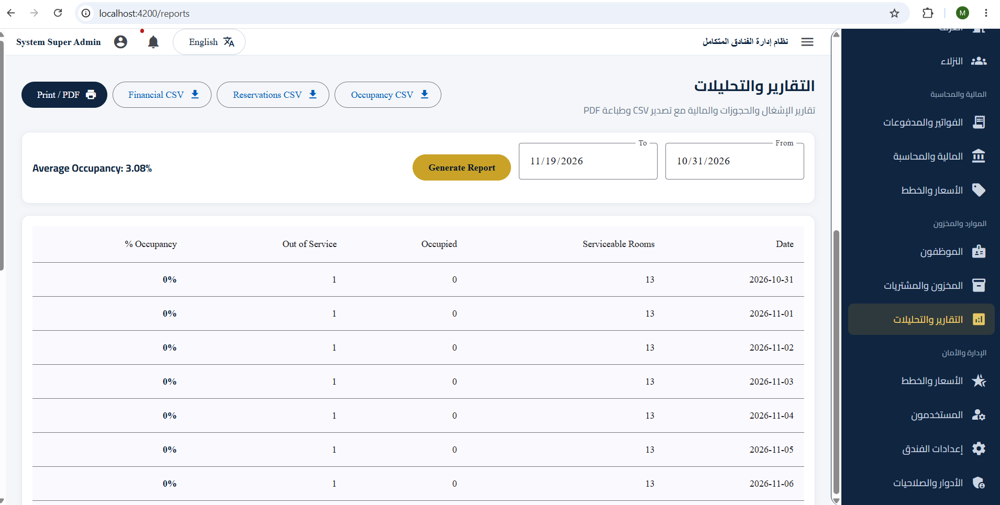 |

| الموظفون والموارد البشرية (Employees & HR) | المخزون والمشتريات (Inventory) |
|---|---|
| 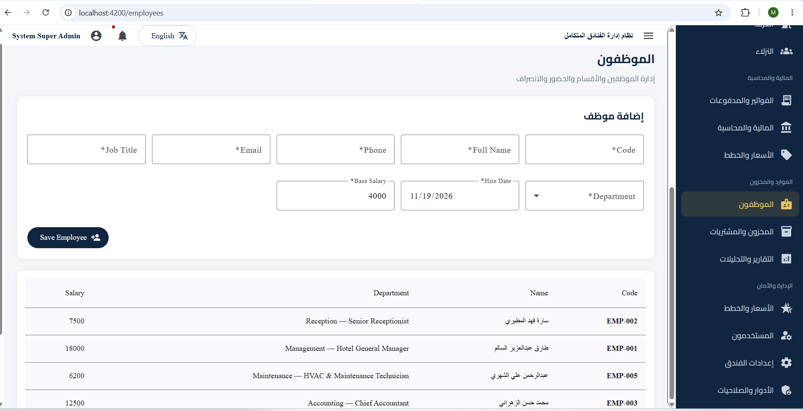 | 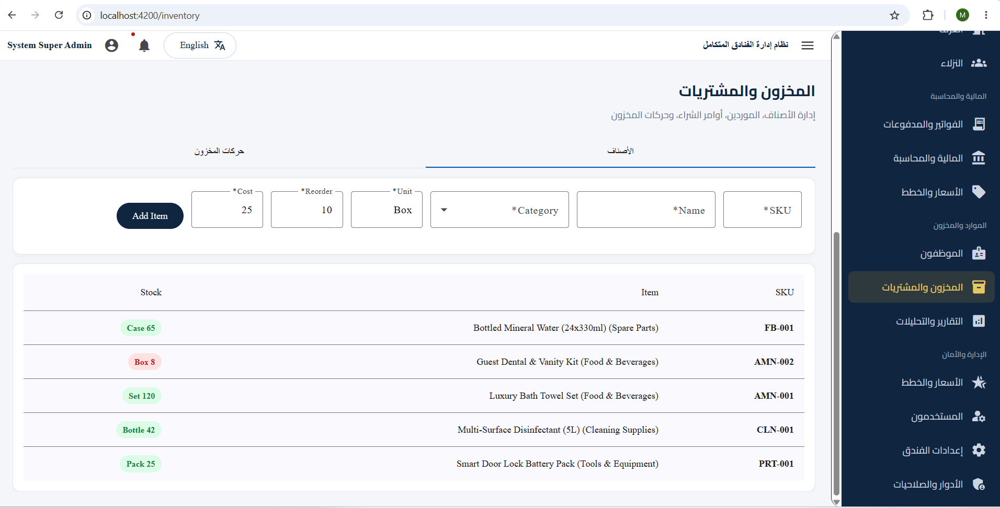 |

| المستخدمون والصلاحيات (Users & Permissions) | دعم اللغتين العربية والإنجليزية (AR/EN Localization) |
|---|---|
| 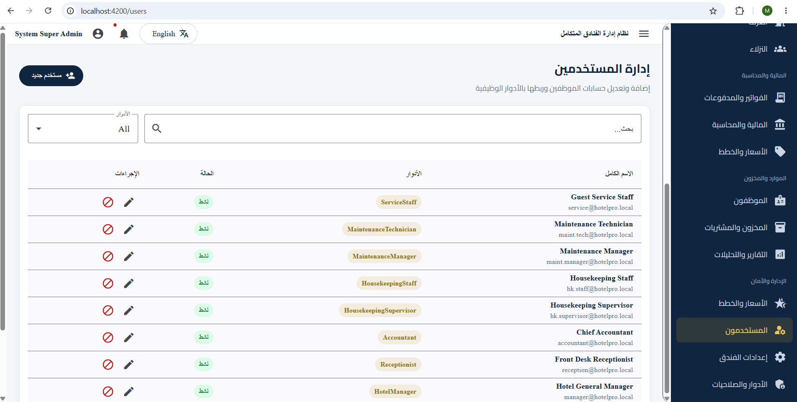 | 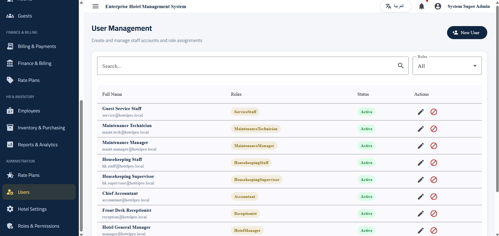 |

---

## التشغيل والإعداد محلياً (Getting Started)

### المتطلبات الأساسية
- [.NET 10 SDK](https://dotnet.microsoft.com/) (الإصدار `10.0+`)
- [Node.js](https://nodejs.org/) (الإصدار `20+`) و npm
- SQL Server أو SQL Server LocalDB (`(localdb)\MSSQLLocalDB`)

### 1. إعداد مفتاح JWT وقاعدة البيانات

سلسلة الاتصال الافتراضية لـ LocalDB موجودة في `backend/HotelPro.API/appsettings.json`.
للتطوير المحلي، قم بتعيين مفتاح `Jwt:SecretKey` عبر User Secrets (لا تقم أبداً برفع أسرار الإنتاج إلى المستودع):

```powershell
cd backend/HotelPro.API
dotnet user-secrets set "Jwt:SecretKey" "YOUR_STRONG_SECRET_KEY_AT_LEAST_32_CHARS"
```

### 2. تطبيق ترحيلات قاعدة البيانات (EF Core Migrations)

```powershell
cd backend
dotnet ef database update --project HotelPro.Infrastructure --startup-project HotelPro.API
```

### 3. تشغيل الواجهة الخلفية (Backend API)

```powershell
cd backend/HotelPro.API
dotnet run
```
- **رابط الـ API**: `http://localhost:5296`
- **واجهة Swagger (في بيئة التطوير)**: `http://localhost:5296/swagger`

### 4. تشغيل الواجهة الأمامية (Angular Frontend)

```powershell
cd frontend/hotelpro-angular
npm install
npm start
```
- **رابط التطبيق**: `http://localhost:4200`

---

## الاختبارات والتحقق من البناء

### اختبارات الواجهة الخلفية
```powershell
cd backend
dotnet test
```

### فحص الأنواع وبناء الإنتاج للواجهة الأمامية
```powershell
cd frontend/hotelpro-angular
npx tsc --noEmit -p tsconfig.app.json
npm run build
```

---

## حسابات التجربة التطويرية (Development Demo Accounts)

عند التشغيل في بيئة `Development`، يقوم `DbInitializer` بإنشاء حسابات تجريبية لجميع الأدوار الـ 9 لتسهيل الاختبار:

| الدور | البريد الإلكتروني | كلمة المرور |
|---|---|---|
| `SuperAdmin` | `superadmin@hotelpro.local` | `Admin@12345` |
| `HotelManager` | `manager@hotelpro.local` | `Manager@12345` |
| `Receptionist` | `reception@hotelpro.local` | `Reception@12345` |
| `Accountant` | `accountant@hotelpro.local` | `Accountant@12345` |
| `HousekeepingSupervisor` | `hk.supervisor@hotelpro.local` | `Housekeep@12345` |
| `HousekeepingStaff` | `hk.staff@hotelpro.local` | `Housekeep@12345` |
| `MaintenanceManager` | `maint.manager@hotelpro.local` | `Maint@12345` |
| `MaintenanceTechnician` | `maint.tech@hotelpro.local` | `Maint@12345` |
| `ServiceStaff` | `service@hotelpro.local` | `Service@12345` |
