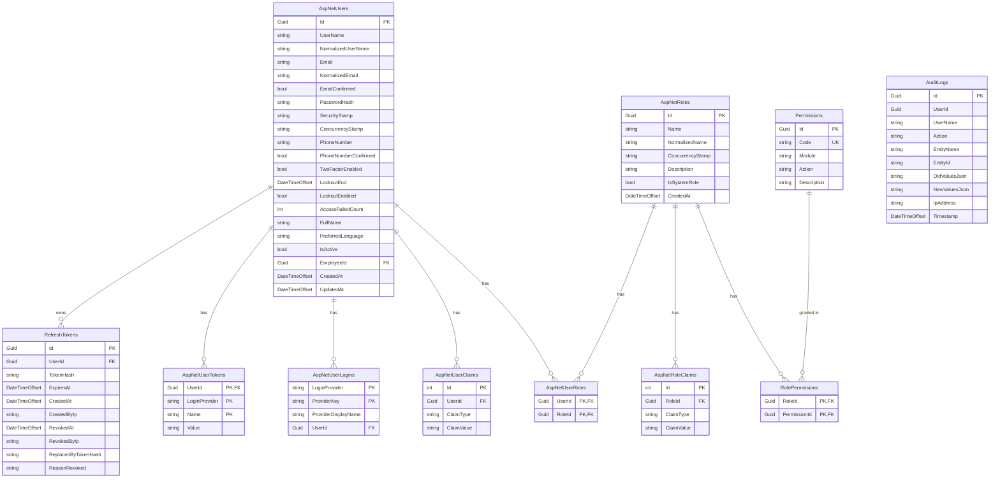
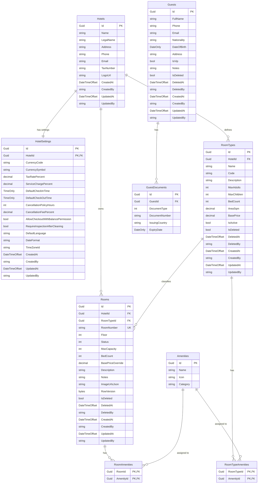
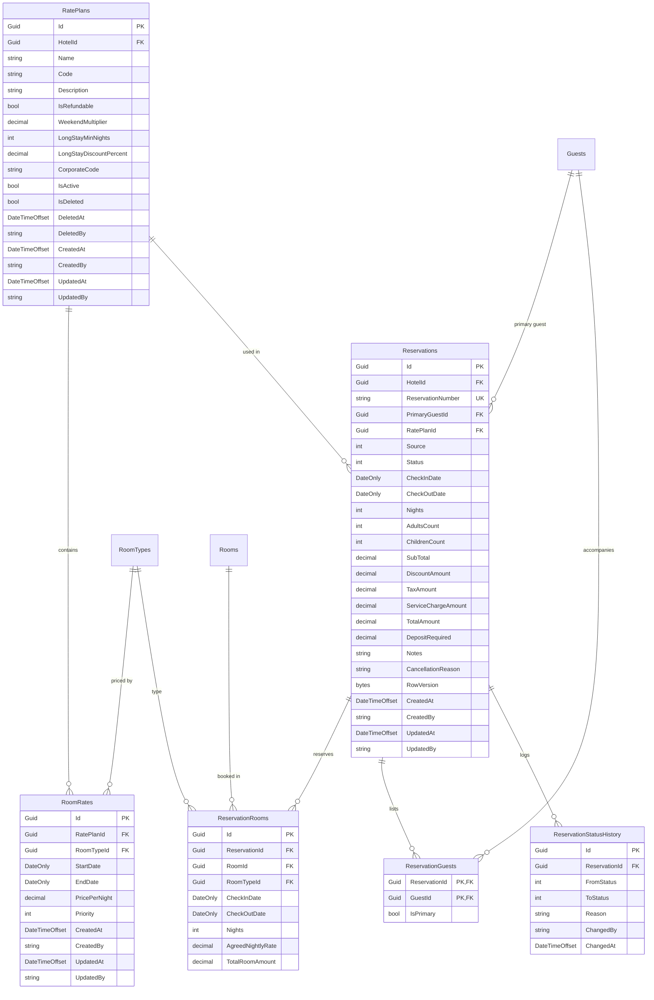
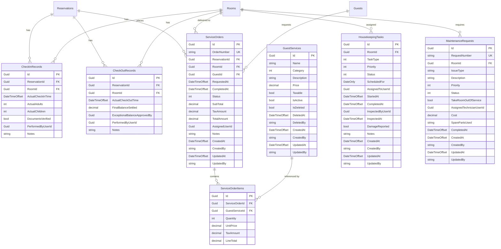
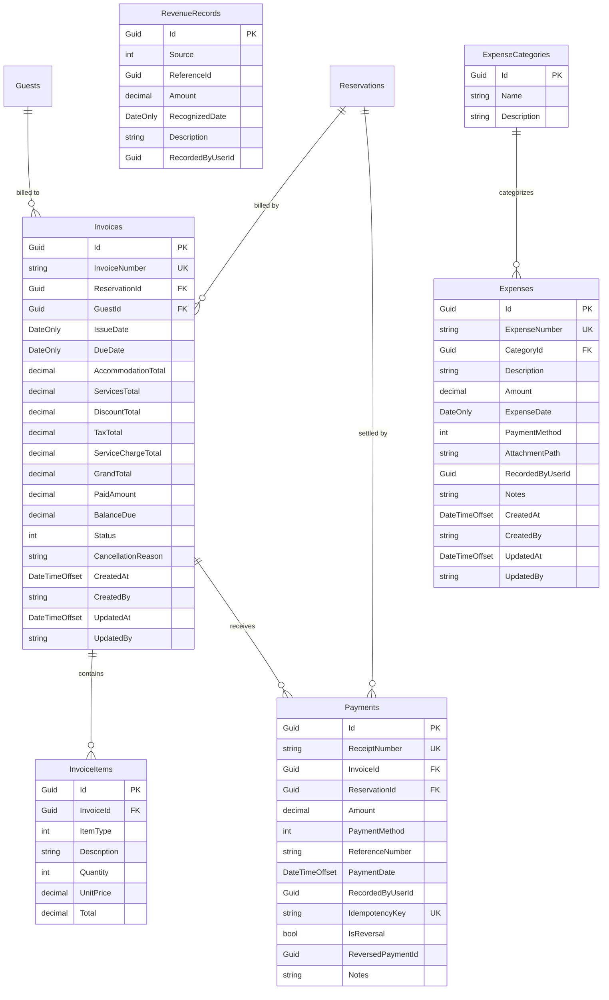
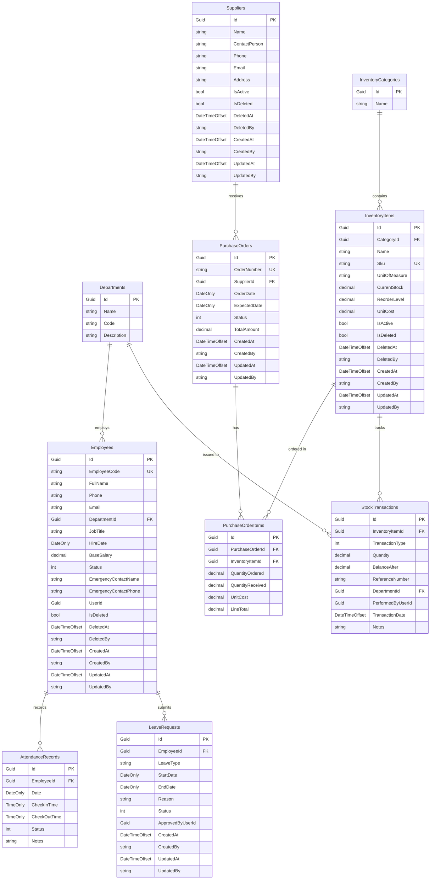
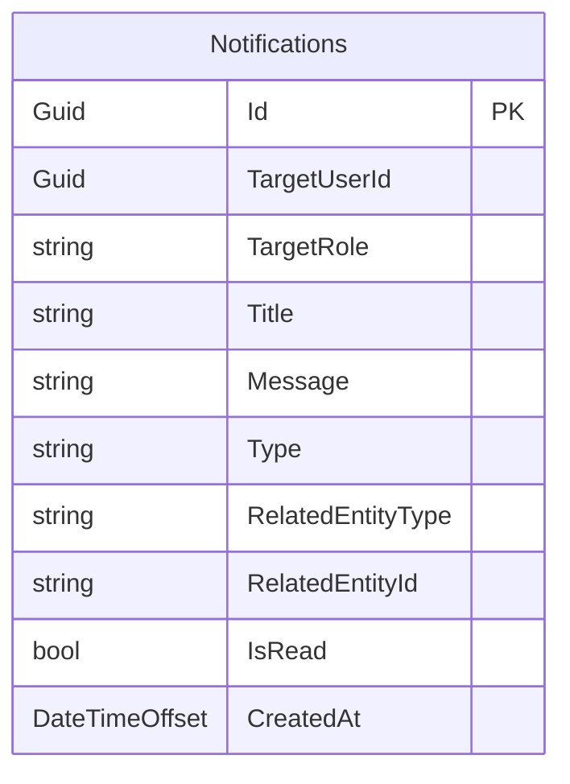

# مخطط قاعدة البيانات الكامل — HotelPro ERD (Entity-Relationship Diagram)

هذا المستند يوثق **البنية الكاملة لقاعدة بيانات نظام HotelPro** (`HotelProDb`) المستخرجة مباشرة من نموذج **Entity Framework Core 10** (`HotelProDbContextModelSnapshot.cs`)، وتشمل **جميع الجداول (48 جدولاً)**، كافة الأعمدة، أنواع البيانات، المفاتيح الأساسية (`PK`)، المفاتيح الأجنبية (`FK`)، القيود الفريدة (`UK`)، والعلاقات بين الوحدات.

---

## نظرة عامة على التصميم

- **عدد الجداول الإجمالي**: **48 جدولاً** (43 جدولاً مجالياً + 5 جداول قياسية لـ ASP.NET Core Identity).
- **المفاتيح الأساسية (`PK`)**: جميع الكيانات المجالية تستخدم `uniqueidentifier` (`Guid`) ما عدا `AspNetRoleClaims` و`AspNetUserClaims` (`int`).
- **الحذف الناعم (Soft Delete)**: مطبق على الكيانات الحساسة (`Guests`, `Rooms`, `RoomTypes`, `RatePlans`, `GuestServices`, `Employees`, `InventoryItems`, `Suppliers`) عبر `IsDeleted`, `DeletedAt`, `DeletedBy`.
- **التحكم بالتزامن (Concurrency)**: مطبق عبر `RowVersion` (`byte[]`) على `Rooms` و`Reservations` لمنع التعارض.
- **التدقيق (Auditing)**: حقول `CreatedAt`, `CreatedBy`, `UpdatedAt`, `UpdatedBy` بالإضافة إلى جدول `AuditLogs`.

---

## 1. المخطط الشامل للنظام (Master System ERD)

يوضح هذا المخطط الترابط الكلي بين جميع وحدات النظام الـ 7:

```mermaid
erDiagram
    %% Identity & HR
    AspNetUsers ||--o{ AspNetUserRoles : "has"
    AspNetRoles ||--o{ AspNetUserRoles : "assigned"
    AspNetRoles ||--o{ RolePermissions : "grants"
    Permissions ||--o{ RolePermissions : "included in"
    AspNetUsers ||--o{ RefreshTokens : "owns"
    Departments ||--o{ Employees : "employs"
    Employees ||--o{ AttendanceRecords : "logs"
    Employees ||--o{ LeaveRequests : "requests"
    Employees |o--o| AspNetUsers : "linked user"

    %% Hotel, Rooms & Guests
    Hotels ||--|| HotelSettings : "configured by"
    Hotels ||--o{ RoomTypes : "defines"
    Hotels ||--o{ Rooms : "contains"
    Hotels ||--o{ RatePlans : "offers"
    Hotels ||--o{ Reservations : "hosts"
    RoomTypes ||--o{ Rooms : "categorizes"
    RoomTypes ||--o{ RoomTypeAmenities : "includes"
    Amenities ||--o{ RoomTypeAmenities : "in"
    Rooms ||--o{ RoomAmenities : "has"
    Amenities ||--o{ RoomAmenities : "in"
    Guests ||--o{ GuestDocuments : "provides"

    %% Rates & Reservations
    RatePlans ||--o{ RoomRates : "prices"
    RoomTypes ||--o{ RoomRates : "priced by"
    Guests ||--o{ Reservations : "primary guest"
    RatePlans ||--o{ Reservations : "applied to"
    Reservations ||--o{ ReservationRooms : "books"
    Rooms ||--o{ ReservationRooms : "assigned"
    RoomTypes ||--o{ ReservationRooms : "type"
    Reservations ||--o{ ReservationGuests : "includes"
    Guests ||--o{ ReservationGuests : "stays in"
    Reservations ||--o{ ReservationStatusHistory : "tracks"

    %% Operations
    Reservations ||--o{ CheckInRecords : "checks in"
    Rooms ||--o{ CheckInRecords : "checked in"
    Reservations ||--o{ CheckOutRecords : "checks out"
    Rooms ||--o{ CheckOutRecords : "checked out"
    Reservations ||--o{ ServiceOrders : "orders"
    Rooms ||--o{ ServiceOrders : "for room"
    Guests ||--o{ ServiceOrders : "by guest"
    ServiceOrders ||--o{ ServiceOrderItems : "contains"
    GuestServices ||--o{ ServiceOrderItems : "ordered as"
    Rooms ||--o{ HousekeepingTasks : "cleaned via"
    Rooms ||--o{ MaintenanceRequests : "repaired via"

    %% Billing & Finance
    Reservations ||--o{ Invoices : "billed by"
    Guests ||--o{ Invoices : "billed to"
    Invoices ||--o{ InvoiceItems : "details"
    Invoices ||--o{ Payments : "settled by"
    Reservations ||--o{ Payments : "paid for"
    ExpenseCategories ||--o{ Expenses : "classifies"

    %% Inventory & Purchasing
    InventoryCategories ||--o{ InventoryItems : "groups"
    Suppliers ||--o{ PurchaseOrders : "supplies"
    PurchaseOrders ||--o{ PurchaseOrderItems : "lines"
    InventoryItems ||--o{ PurchaseOrderItems : "ordered"
    InventoryItems ||--o{ StockTransactions : "moves"
    Departments ||--o{ StockTransactions : "consumed by"
```

---

## 2. المخططات التفصيلية حسب الوحدات (كل الأعمدة والأنواع)

### الوحدة 1: الهوية والصلاحيات والأمان (Identity, RBAC & Audit)

---

### الوحدة 2: إعدادات الفندق والغرف والنزلاء (Hotel Setup, Rooms & Guests)

---

### الوحدة 3: خطط الأسعار والحجوزات (Rates & Reservations)

---

### الوحدة 4: العمليات الفندقية (Operations: Front Desk, Guest Services, Housekeeping, Maintenance)

---

### الوحدة 5: الفوترة والمدفوعات والمالية (Billing, Payments & Finance)

---

### الوحدة 6: الموارد البشرية والمخزون والمشتريات (HR & Inventory)

---

### الوحدة 7: الإشعارات (Notifications)

---

## 3. مرجع العلاقات المنطقية عبر الوحدات (Cross-Module Logical References)

بعض الأعمدة تمثل ارتباطات منطقية معرفية (`Guid`) دون قيد `FOREIGN KEY` صلب في SQL Server لتجنب مسارات الحذف المتسلسل المتعددة (`Multiple Cascade Paths`) أو لدعم التوسع المستقبلي:

| الجدول | العمود | الكيان المرتبط | الغرض |
|---|---|---|---|
| `AspNetUsers` | `EmployeeId` | `Employees.Id` | ربط حساب المستخدم بملف الموظف |
| `Employees` | `UserId` | `AspNetUsers.Id` | ربط الموظف بحساب الدخول |
| `CheckInRecords` / `CheckOutRecords` | `PerformedByUserId` | `AspNetUsers.Id` | موظف الاستقبال المنفذ |
| `CheckOutRecords` | `ExceptionalBalanceApprovedBy` | `AspNetUsers.Id` | المدير الموافق على المغادرة برصيد متبقٍ |
| `HousekeepingTasks` | `AssignedToUserId`, `InspectedByUserId` | `AspNetUsers.Id` | عامل النظافة والمشرف المفتش |
| `MaintenanceRequests` | `AssignedTechnicianUserId` | `AspNetUsers.Id` | فني الصيانة المعين |
| `ServiceOrders` | `AssignedUserId` | `AspNetUsers.Id` | الموظف المكلف بالطلب |
| `Payments` | `ReversedPaymentId` | `Payments.Id` | ربط قيد العكس بعملية الدفع الأصلية |
| `Payments` / `Expenses` / `RevenueRecords` / `StockTransactions` | `RecordedByUserId` / `PerformedByUserId` | `AspNetUsers.Id` | المستخدم الذي سجل الحركة المالية أو المخزنية |
| `RevenueRecords` | `ReferenceId` | `Invoices.Id` / `Payments.Id` | المرجع المصدري للإيراد |
| `LeaveRequests` | `ApprovedByUserId` | `AspNetUsers.Id` | المدير المعتمد للإجازة |
| `Notifications` | `TargetUserId`, `RelatedEntityId` | `AspNetUsers.Id` / Any Entity | المستخدم المستهدف والكيان المرتبط بالإشعار |

